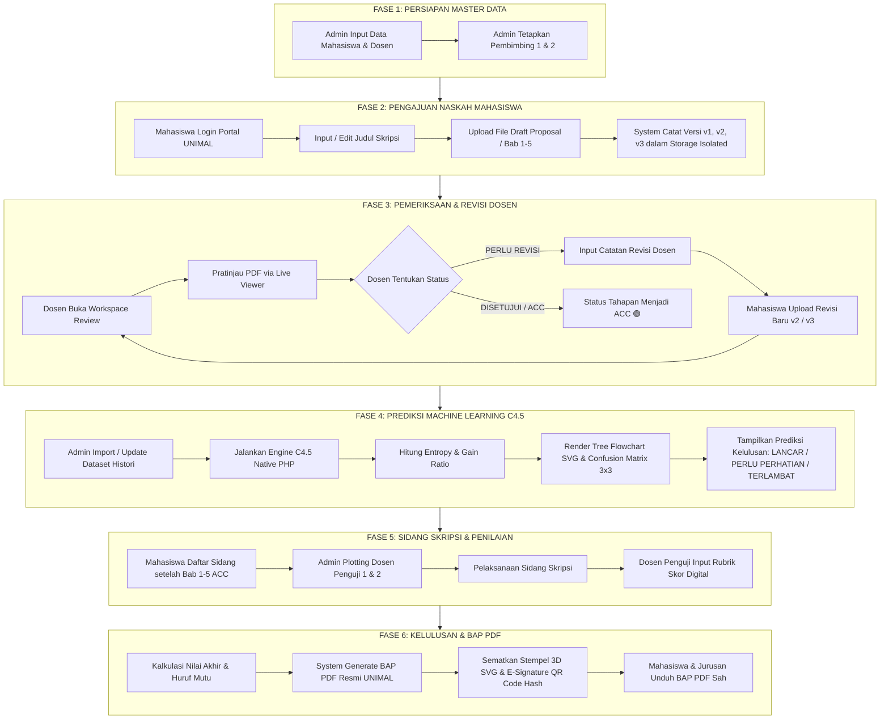
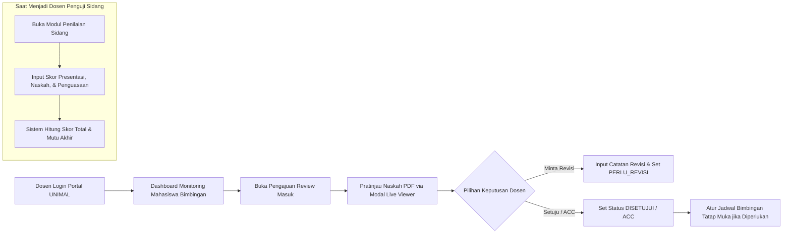
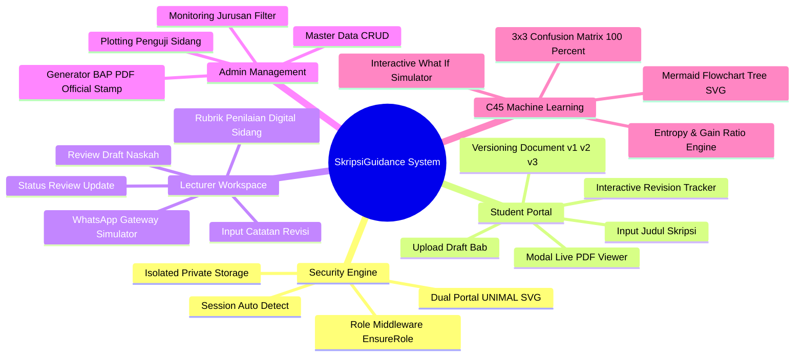

# PRD ALUR & ARSITEKTUR SISTEM (GAMBARAN ALUR KERJA SKRIPSIGUIDANCE)

**NAMA SISTEM:** SkripsiGuidance  
**INSTITUSI:** Universitas Malikussaleh (UNIMAL) — Jurusan Teknik Informatika  
**TUJUAN DOKUMEN:** Panduan Visual & Diagram Alur Lengkap Perjalanan Data Sistem dari Registrasi Hingga Kelulusan Sidang & BAP PDF.

---

## 🗺️ 1. PETA GAMBARAN BESAR KEMANA SISTEM INI (MASTER SYSTEM DESTINATION MAP)

Sistem Informasi Bimbingan Skripsi ini dirancang untuk mengubah proses bimbingan manual yang sporadis menjadi **ekosistem akademik terintegrasi berstandar digital**. 

Gambar di bawah ini menunjukkan kemana data mengalir dalam 6 fase utama:



---

## 🎓 2. JOURNEY MAP MAHASISWA (LANGKAH DEMI LANGKAH MAHASISWA)

Berikut adalah perjalanan penuh seorang mahasiswa dari awal hingga lulus sidang:

```mermaid
sequenceDiagram
    autonumber
    actor M as Mahasiswa UNIMAL
    participant S as Sistem Web Skripsi
    actor D as Dosen Pembimbing
    actor A as Admin Jurusan

    M->>S: 1. Login ke Portal Mahasiswa (/login)
    M->>S: 2. Input/Edit Judul Skripsi Aktif
    M->>S: 3. Unggah Berkas Draft Bab (Format PDF/DOCX)
    S->>S: 4. Catat Riwayat Versi Dokumen (v1, v2, v3)
    S font-weight: 5. Notifikasi Pengajuan Masuk ke Dosen
    D->>S: 6. Periksa Berkas & Masukkan Catatan Revisi
    alt Jika Status PERLU REVISI ⚠️
        S->>M: 7. Widget Tracker Tampilkan Badge Kuning ⚠️ + Quote Catatan Dosen
        M->>S: 8. Unggah Berkas Revisi Baru (Otomatis Menjadi Versi v2 / v3)
    else Jika Status DISETUJUI 🟢
        S->>M: 9. Widget Tracker Tampilkan Badge Hijau 🟢 (ACC)
    end
    M->>S: 10. Mengajukan Pendaftaran Sidang Skripsi (Setelah Bab 1-5 ACC)
    A->>S: 11. Konfirmasi Jadwal & Plotting Penguji
    M->>S: 12. Unduh Berita Acara Sidang (BAP) PDF Resmi
```

---

## 👨‍🏫 3. JOURNEY MAP DOSEN (LANGKAH DEMI LANGKAH DOSEN)

Alur kerja Dosen Pembimbing dan Dosen Penguji di dalam aplikasi:



---

## 🛠️ 4. JOURNEY MAP ADMIN (LANGKAH DEMI LANGKAH ADMINISTRATOR)

Alur kerja Administrator Program Studi / Jurusan:

```mermaid
flowchart TD
    A[Admin Login Portal UNIMAL] --> B[Kelola Master Data: Mahasiswa, Dosen, Periode]
    B --> C[Penetapan Pembimbing 1 & Pembimbing 2]
    C --> D[Monitoring Seluruh Bimbingan Jurusan /admin/guidance]
    D --> E{Filter Status Bimbingan}
    E -->|PERLU_REVISI| F[Pantau Mahasiswa Terhambat Revisi]
    E -->|DISETUJUI| G[Pantau Mahasiswa Siap Sidang]
    
    subgraph ENGINE_C45 [Modul Machine Learning C4.5]
        H[Buka /admin/classification] --> I[Import 50 Dataset Histori Bimbingan]
        I --> J[Klik 'Jalankan Pelatihan C4.5']
        J --> K[Lihat Pohon Keputusan Flowchart SVG & Confusion Matrix 3x3]
        K --> L[Uji Simulator Interaktif What-If C4.5 Live]
    end

    subgraph MODUL_SIDANG [Modul Sidang & BAP PDF]
        M[Buka /admin/defenses] --> N[Plotting Dosen Penguji 1 & 2]
        N --> O[Cetak Berita Acara Sidang BAP PDF Resmi UNIMAL]
    </div>
```

---

## ⚡ 5. INTEGRASI TEKNIS ENGINES & FITUR ADVANCED



---

## 📌 6. RINGKASAN GAMBARAN AKHIR (KEMANA SISTEM INI BERJALAN)

Dengan alur sistem di atas, **SkripsiGuidance Universitas Malikussaleh** berjalan menuju 3 hasil akhir utama:

1. **Bagi Mahasiswa**: Memiliki kepastian status revisi tiap bab secara visual dan riwayat dokumen yang rapi ($v1 \rightarrow v2 \rightarrow v3$).
2. **Bagi Dosen & Admin**: Memiliki transparansi riwayat bimbingan, verifikasi naskah secara *online*, serta kemudahan pembuatan BAP PDF otomatis.
3. **Bagi Program Studi**: Memiliki alat *Machine Learning C4.5* yang dapat **mengidentifikasi lebih awal** mahasiswa yang berisiko terlambat lulus sehingga dapat diberikan intervensi bimbingan lebih dini.

---
*Dokumen PRD Alur & Arsitektur Sistem ini dirancang untuk memberikan gambaran komprehensif alur kerja perangkat lunak SkripsiGuidance.*
