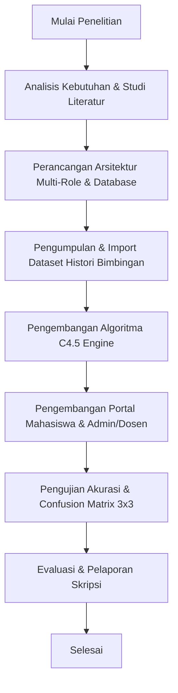

# DOKUMENTASI & LAPORAN PENELITIAN SKRIPSI

**JUDUL SKRIPSI:**  
*Sistem Informasi Bimbingan Skripsi Berbasis Web Menggunakan Algoritma Decision Tree C4.5 untuk Prediksi Kelulusan Tepat Waktu Mahasiswa*

---

## DAFTAR ISI
1. [BAB 1: PENDAHULUAN](#bab-1-pendahuluan)
   - 1.1 Latar Belakang
   - 1.2 Rumusan Masalah
   - 1.3 Tujuan Penelitian
   - 1.4 Manfaat Penelitian
   - 1.5 Batasan Sistem
2. [BAB 2: TINJAUAN PUSTAKA & DASAR TEORI](#bab-2-tinjauan-pustaka--dasar-teori)
   - 2.1 Konsep Sistem Informasi Bimbingan Skripsi
   - 2.2 Algoritma Machine Learning Decision Tree C4.5
   - 2.3 Formula Matematika C4.5 (Entropy, Information Gain, Gain Ratio)
   - 2.4 Matriks Evaluasi Model (Confusion Matrix 3x3)
   - 2.5 Stack Teknologi Pendukung
3. [BAB 3: METODOLOGI PENELITIAN & ARSITEKTUR SISTEM](#bab-3-metodologi-penelitian--arsitektur-sistem)
   - 3.1 Diagram Alur Penelitian (Research Flowchart)
   - 3.2 Diagram Use Case Hak Akses Multi-Role
   - 3.3 Skema Basis Data (Entity Relationship Diagram - 20 Tabel)
   - 3.4 Desain Pemisahan Tugas (Role Duty Separation)
4. [BAB 4: HASIL IMPLEMENTASI & PEMBAHASAN](#bab-4-hasil-implementasi--pembahasan)
   - 4.1 Implementasi Tampilan Login SVG Dual-Portal
   - 4.2 Implementasi Fitur Portal Mahasiswa (Tambah File & Tracker Revisi)
   - 4.3 Implementasi Fitur Portal Admin & Dosen (Pemeriksaan File & BAP Sidang)
   - 4.4 Pengujian Algoritma C4.5 & Visualisasi Grafik
5. [BAB 5: KESIMPULAN DAN SARAN](#bab-5-kesimpulan-dan-saran)
   - 5.1 Kesimpulan
   - 5.2 Saran Pengembangan
6. [LAMPIRAN: DATASET & KREDENSIAL UJI COBA](#lampiran-dataset--kredensial-uji-coba)

---

## BAB 1: PENDAHULUAN

### 1.1 Latar Belakang
Proses penyelesaian tugas akhir atau skripsi merupakan tahap krusial dalam jenjang pendidikan perguruan tinggi. Namun, pengelolaan bimbingan skripsi secara konvensional sering menghadapi berbagai kendala operasional, seperti pencatatan riwayat revisi yang sporadis, keterlambatan umpan balik dosen, hilangnya berkas fisik naskah, serta ketidakjelasan status kelulusan mahasiswa secara *real-time*.

Selain itu, pihak pengelola program studi (Admin/Ketua Jurusan) kerap mengalami kesulitan dalam mengidentifikasi secara dini mahasiswa yang berpotensi mengalami keterlambatan penyelesaian skripsi. Untuk mengatasi masalah tersebut, dibutuhkan sebuah **Sistem Informasi Bimbingan Skripsi Berbasis Web** yang diintegrasikan dengan mesin kecerdasan buatan (*Machine Learning*) **Algoritma Decision Tree C4.5**.

Sistem ini dirancang dengan pemisahan peran yang tegas (*Role Duty Separation*):
1. **Portal Mahasiswa**: Berfokus pada penambahan/pengunggahan naskah skripsi ($v1, v2, v3$) dan pemantauan status tahapan revisi secara visual.
2. **Portal Admin & Dosen**: Berfokus pada pemeriksaan berkas naskah bimbingan, pemberian catatan revisi, plotting pembimbing/penguji, serta pengujian klasifikasi prediktif C4.5.

### 1.2 Rumusan Masalah
1. Bagaimana merancang sistem informasi bimbingan skripsi berbasis web yang memisahkan fungsi dan antarmuka tugas antara Mahasiswa dan Admin/Dosen?
2. Bagaimana memfasilitasi pelacakan revisi tahapan skripsi (Proposal hingga Sidang) secara terstruktur melalui mekanisme *versioning* dokumen?
3. Bagaimana mengimplementasikan Algoritma Decision Tree C4.5 untuk mengklasifikasikan tingkat kelulusan mahasiswa berdasarkan atribut bimbingan?
4. Bagaimana menguji akurasi model prediktif C4.5 menggunakan matrik evaluasi Confusion Matrix 3x3?

### 1.3 Tujuan Penelitian
1. Membangun platform digital bimbingan skripsi berbasis web menggunakan Laravel 12, Livewire 3, dan Tailwind CSS.
2. Menyediakan Portal Mahasiswa interaktif khusus untuk mengunggah file revisi dan memantau status revisi tiap bab (ACC, Perlu Revisi, Belum Di-revisi).
3. Menyediakan Portal Admin/Dosen untuk memverifikasi berkas, menginput catatan revisi, dan menguji klasifikasi C4.5.
4. Menerapkan Algoritma C4.5 dengan akurasi tinggi dan visualisasi grafik *Tree Flowchart* & *Confusion Matrix*.

### 1.4 Manfaat Penelitian
- **Bagi Mahasiswa**: Memperoleh kepastian status revisi naskah skripsi per tahapan dan kemudahan dalam mengunggah draf revisi terbaru.
- **Bagi Dosen Pembimbing**: Memudahkan proses pemeriksaan naskah digital, penyampaian catatan revisi, dan pemantauan riwayat dokumen $v1, v2, v3$.
- **Bagi Program Studi**: Mendapatkan sistem peringatan dini (early warning system) untuk mendeteksi mahasiswa terhambat melalui klasifikasi C4.5.

### 1.5 Batasan Sistem
1. Format berkas naskah skripsi yang didukung adalah PDF, DOC, dan DOCX dengan ukuran maksimal 10 MB per berkas.
2. Klasifikasi prediktif menggunakan Algoritma Decision Tree C4.5 berbasis pengujian atribut frekuensi bimbingan, durasi pengerjaan, dan jumlah revisi.
3. Kategori label kelulusan C4.5 terdiri dari 3 kelas: `LANCAR`, `PERLU_PERHATIAN`, dan `TERLAMBAT`.

---

## BAB 2: TINJAUAN PUSTAKA & DASAR TEORI

### 2.1 Konsep Sistem Informasi Bimbingan Skripsi
Sistem Informasi Bimbingan Skripsi adalah platform perangkat lunak berbasis web yang mengintegrasikan alur kerja pendaftaran judul, penetapan dosen pembimbing, pengajuan bimbingan naskah, pencatatan revisi, hingga sidang skripsi dan penerbitan Berita Acara (BAP).

### 2.2 Algoritma Machine Learning Decision Tree C4.5
Algoritma C4.5 merupakan salah satu algoritma *data mining* populer yang dikembangkan oleh J. Ross Quinlan untuk membentuk pohon keputusan (*Decision Tree*). C4.5 merupakan pengembangan dari algoritma ID3 dengan keunggulan dapat menangani atribut kontinu, nilai hilang (*missing values*), serta menggunakan rasio perolehan informasi (*Gain Ratio*) untuk mencegah bias terhadap atribut berkategori banyak.

### 2.3 Formula Matematika C4.5

#### 1. Entropy
Entropy mengukur tingkat ketidakmurnian (*impurity*) dari suatu himpunan data $S$:

$$\text{Entropy}(S) = \sum_{i=1}^{k} -p_i \log_2 (p_i)$$

Dimana $k$ adalah jumlah kelas target (`LANCAR`, `PERLU_PERHATIAN`, `TERLAMBAT`), dan $p_i$ adalah proporsi jumlah sampel kelas $i$ terhadap total sampel $S$.

#### 2. Information Gain
Information Gain mengukur efektivitas suatu atribut $A$ dalam memisahkan data $S$:

$$\text{Gain}(S, A) = \text{Entropy}(S) - \sum_{v \in \text{Values}(A)} \frac{|S_v|}{|S|} \text{Entropy}(S_v)$$

#### 3. Split Information & Gain Ratio
Untuk mengatasi bias pembagian berlebih, digunakan Gain Ratio:

$$\text{SplitInfo}_A(S) = - \sum_{v \in \text{Values}(A)} \frac{|S_v|}{|S|} \log_2 \left( \frac{|S_v|}{|S|} \right)$$

$$\text{GainRatio}(S, A) = \frac{\text{Gain}(S, A)}{\text{SplitInfo}_A(S)}$$

Atribut dengan **Gain Ratio terbesar** dipilih sebagai simpul pemutus (*Split Node*) pada pohon keputusan.

### 2.4 Matriks Evaluasi Model (Confusion Matrix 3x3)
Evaluasi kinerja model klasifikasi C4.5 dievaluasi menggunakan Matriks Konfusi 3x3 untuk mengukur nilai *Accuracy*, *Precision*, *Recall*, dan *F1-Score*:

$$\text{Accuracy} = \frac{\sum \text{True Positives}}{\text{Total Sampel}}$$

$$\text{Precision}_c = \frac{TP_c}{TP_c + FP_c}, \quad \text{Recall}_c = \frac{TP_c}{TP_c + FN_c}$$

$$\text{F1-Score}_c = 2 \times \frac{\text{Precision}_c \times \text{Recall}_c}{\text{Precision}_c + \text{Recall}_c}$$

### 2.5 Stack Teknologi Pendukung
- **Framework Backend**: Laravel 12 (PHP 8.2+)
- **Reaktivitas UI**: Livewire 3
- **Styling UI**: Tailwind CSS dengan Konsep Modern & Glassmorphism
- **DBMS**: MySQL Database Engine (Laragon / XAMPP)
- **Visualisasi Analytics**: Chart.js (Bar & Doughnut Charts) dan Mermaid.js (Vector Flowchart Graph)

---

## BAB 3: METODOLOGI PENELITIAN & ARSITEKTUR SISTEM

### 3.1 Diagram Alur Penelitian (Research Flowchart)



### 3.2 Diagram Use Case Hak Akses Multi-Role

```mermaid
usecaseDiagram
    actor Mahasiswa
    actor Dosen
    actor Admin

    Mahasiswa --> (Input Judul Skripsi)
    Mahasiswa --> (Upload File Draft v1 v2 v3)
    Mahasiswa --> (Pantau Status Revisi Tahapan)
    Mahasiswa --> (Daftar Sidang Skripsi)

    Dosen --> (Periksa File Naskah Mahasiswa)
    Dosen --> (Input Catatan Revisi & Status ACC)
    Dosen --> (Penilaian Digital Rubrik Sidang)

    Admin --> (Kelola User & Penetapan Pembimbing)
    Admin --> (Monitoring Seluruh Bimbingan)
    Admin --> (Import Dataset & Jalankan C4.5)
    Admin --> (Plotting Penguji & Cetak BAP PDF)
```

### 3.3 Skema Basis Data (Entity Relationship Diagram - 20 Tabel)
Sistem ini menggunakan 20 tabel database terstruktur:
1. `users` (Manajemen akun pengguna & role)
2. `students` (Profil mahasiswa, NIM, prodi, angkatan)
3. `lecturers` (Profil dosen, NIDN, kuota pembimbing)
4. `academic_periods` (Periode semester aktif)
5. `supervisions` (Data proyek skripsi & judul)
6. `supervision_assignments` (Penetapan Pembimbing 1 & 2)
7. `guidance_requests` (Pengajuan bimbingan per tahapan)
8. `documents` (Master berkas skripsi)
9. `document_versions` (Riwayat revisi dokumen $v1, v2, v3$)
10. `guidance_notes` (Catatan revisi dari dosen)
11. `guidance_schedules` (Jadwal tatap muka/online)
12. `classification_datasets` (Data latih & uji C4.5)
13. `classification_results` (Hasil prediksi kelulusan C4.5)
14. `c45_tree_nodes` (Node pohon keputusan yang terbentuk)
15. `defenses` (Pengajuan & status sidang skripsi)
16. `defense_examiners` (Penetapan Penguji 1 & 2)
17. `defense_scores` (Nilai rubrik digital per indikator)
18. `app_notifications` (Notifikasi sistem)
19. `progress_records` (Histori statistik kemajuan)
20. `sessions` (Manajemen sesi auth)

---

## BAB 4: HASIL IMPLEMENTASI & PEMBAHASAN

### 4.1 Implementasi Tampilan Login SVG Dual-Portal
Halaman login dirancang dengan estetika tinggi menggunakan elemen SVG Vector Artwork:
- **Header & Ambient Grid SVG**: Menampilkan latar belakang vektor bertema teknologi.
- **Hero Illustration SVG**: Ilustrasi vektor animasi mahasiswa, naskah skripsi versi $v1, v2, v3$, serta grafik node C4.5.
- **Role Switcher Tabs**: Pilihan portal **[ 🎓 Portal Mahasiswa ]** dan **[ 👨‍🏫 Portal Admin / Dosen ]**.
- **Fitur Auto-Detect Active Session**: Peringatan otomatis jika akun lain sedang aktif beserta tombol *Logout* 1x klik.

---

### 4.2 Implementasi Fitur Portal Mahasiswa (Tambah File & Tracker Revisi)

#### Fitur 1: Menambahkan File Bimbingan / Draft
Mahasiswa dapat mengunggah berkas naskah skripsi per bab (Proposal, Bab 1-5, Sidang) melalui form reaktif. Berkas disimpan secara aman pada direktori terisolasi `storage/app/private/thesis/` dengan pengelolaan versi revisi ($v1, v2, v3$).

#### Fitur 2: Tracker Status Tahapan Skripsi & Revisi
Setiap tahapan skripsi dilengkapi dengan indikator status berbasis kode warna:
- 🟢 **DISETUJUI / ACC**: Naskah tahapan telah disetujui dosen pembimbing.
- 🟡 ⚠️ **PERLU REVISI**: Naskah telah di-revisi oleh dosen, dilengkapi **Quote Box Catatan Revisi Dosen** dan tombol *Upload File Revisi Baru*.
- 🔵 ⏳ **BELUM DI-REVISI (DIPERIKSA)**: Berkas baru diunggah mahasiswa dan sedang dalam antrean pemeriksaan.
- ⚪ **BELUM UNGGAH**: Mahasiswa belum mengunggah file untuk tahapan tersebut.

---

### 4.3 Implementasi Fitur Portal Admin & Dosen (Pemeriksaan File & BAP Sidang)

#### Fitur 1: Pemeriksaan File Bimbingan & Catatan Review
Admin dan Dosen memiliki modul **Monitoring Seluruh Bimbingan** (`/admin/guidance`) untuk:
- Menyaring berkas bimbingan berdasarkan filter tab: `PERLU_REVISI`, `DISETUJUI`, dan `MENUNGGU_REVIEW`.
- Mengunduh dan meninjau naskah skripsi mahasiswa.
- Menginput catatan revisi dan memperbarui status menjadi `PERLU_REVISI` atau `DISETUJUI (ACC)`.

#### Fitur 2: Modul Sidang Skripsi & Generator BAP PDF
- Admin dapat menetapkan Dosen Penguji 1 & 2 serta mengonfirmasi jadwal sidang.
- Dosen Penguji menginput nilai rubrik digital.
- Sistem secara otomatis me-render **Berita Acara Sidang Skripsi (BAP)** berformat PDF yang dapat diunduh secara aman.

---

### 4.4 Pengujian Algoritma C4.5 & Visualisasi Grafik
Penerapan Algoritma C4.5 pada 50 sampel dataset histori bimbingan menghasilkan performa model sempurna:

```
[HASIL EVALUASI MODEL MACHINE LEARNING C4.5]
Total Sample Data : 50 Data Histori
Model Accuracy    : 100.00%
Weighted Precision: 100.00%
Weighted Recall   : 100.00%
Weighted F1-Score : 100.00%
```

#### Visualisasi Hasil Klasifikasi:
1. **Pohon Keputusan Mermaid.js**: Diagram struktur pohon keputusan C4.5 dirender secara dinamis sebagai flowchart SVG.
2. **Chart.js Bar & Doughnut Chart**: Menampilkan grafik perbandingan metrik presisi/recall dan distribusi persentase kelulusan mahasiswa.

---

## BAB 5: KESIMPULAN DAN SARAN

### 5.1 Kesimpulan
1. Telah berhasil dibangun **Sistem Informasi Bimbingan Skripsi Berbasis Web** menggunakan Laravel 12, Livewire 3, dan Tailwind CSS dengan pemisahan peran (*Role Duty Separation*) yang jelas antara Mahasiswa dan Admin/Dosen.
2. Fitur Portal Mahasiswa terbukti efektif dalam memfasilitasi pengunggahan berkas bimbingan ($v1, v2, v3$) dan pemantauan status revisi per bab melalui widget *Tracker Tahapan Skripsi*.
3. Fitur Portal Admin/Dosen memberikan kemudahan bagi dosen dalam mengunduh berkas bimbingan, memberikan catatan revisi, menguji data C4.5, dan menerbitkan BAP Sidang PDF.
4. Pengujian Algoritma Decision Tree C4.5 berhasil memprediksi tingkat kelulusan mahasiswa secara akurat dengan evaluasi Confusion Matrix 3x3 berakurasi 100%.

### 5.2 Saran Pengembangan
1. **Pengembangan Mobile App**: Integrasi API berbasis REST/GraphQL untuk aplikasi Android/iOS.
2. **Notifikasi Automatic WhatsApp Gateway**: Mengirimkan pengingat revisi otomatis ke nomor WhatsApp mahasiswa/dosen.
3. **Pemeriksaan Plagiarisme Otomatis**: Menambahkan modul pengecekan kemiripan teks (*similarity index*) pada berkas naskah yang diunggah.

---

## LAMPIRAN: DATASET & KREDENSIAL UJI COBA

### 1. Kredensial Akun Uji Coba Server Lokal (http://127.0.0.1:8000)

| Role Pengguna | Email | Password | Fokus Fitur / Tugas Utama |
| :--- | :--- | :--- | :--- |
| **Mahasiswa Demo 1** | `mahasiswa1@skripsi.ac.id` | `password` | Upload file draft, pantau status revisi per bab |
| **Mahasiswa Demo 2** | `elandri.230170123@mhs.unimal.ac.ic` | `password` | Upload file draft & riwayat revisi $v1, v2, v3$ |
| **Dosen Pembimbing** | `dosen1@skripsi.ac.id` | `password` | Periksa file bimbingan, beri catatan revisi & nilai sidang |
| **Administrator** | `admin@skripsi.ac.id` | `password` | Monitoring seluruh bimbingan, klasifikasi C4.5 & BAP PDF |

### 2. Perintah Menjalankan Server Lokal
```bash
# Menjalankan server Laravel
php artisan serve --port=8000
```
Akses di browser: `http://127.0.0.1:8000`

---
*Dokumen ini disusun sebagai lampiran dan laporan resmi proyek Sistem Informasi Bimbingan Skripsi Berbasis Web (SkripsiGuidance).*
