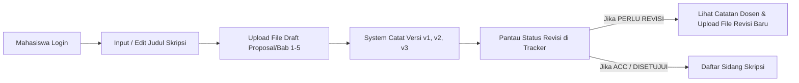

# PRD & SPESIFIKASI FITUR SISTEM WEB SKRIPSI (SKRIPSIGUIDANCE)

**DOKUMEN REQUIREMENT & SPESIFIKASI TEKNIS LENGKAP UNTUK LAPORAN SKRIPSI**

---

## 1. DESKRIPSI PRODUK & TUJUAN SISTEM
**SkripsiGuidance** adalah platform Sistem Informasi Bimbingan Skripsi Berbasis Web yang dirancang untuk mengintegrasikan seluruh alur kerja tugas akhir di perguruan tinggi — mulai dari pendaftaran judul, penetapan dosen pembimbing, pengajuan naskah per bab, pencatatan riwayat revisi dokumen ($v1, v2, v3$), prediksi kelulusan menggunakan **Algoritma Machine Learning Decision Tree C4.5**, hingga pelaksanaan sidang skripsi dan penerbitan **Berita Acara Sidang (BAP) PDF**.

Sistem ini mengusung **Role Duty Separation** (Pemisahan Tugas Antar Portal):
- **Portal Mahasiswa**: Berfokus pada penambahan file bimbingan baru & pemantauan status revisi tahapan.
- **Portal Admin & Dosen**: Berfokus pada pemeriksaan naskah digital, pemberian catatan revisi, plotting penguji, pengujian C4.5, dan penerbitan BAP PDF.

---

## 2. DEDAH FULL FITUR SISTEM PER MODUL (FULL FEATURE MATRIX)

### 🚪 MODUL 1: AUTENTIKASI & MULTI-ROLE SECURITY ENGINE

| ID Fitur | Nama Fitur | Deskripsi & Fungsi Teknis | Role Pengguna | Status |
| :--- | :--- | :--- | :--- | :--- |
| **SEC-01** | **Tampilan Login SVG Dual-Portal** | Halaman login futuristik dengan latar belakang vektor SVG, ilustrasi animasi C4.5 & naskah, serta tab switcher **[🎓 Portal Mahasiswa]** dan **[👨‍🏫 Portal Admin/Dosen]**. | All Users | ✅ Active |
| **SEC-02** | **Session Auto-Detect & 1-Click Logout** | Mendeteksi jika akun pengguna sedang login di browser. Menampilkan banner peringatan aktif beserta tombol **`[ Keluar / Logout ]`** 1x klik. | All Users | ✅ Active |
| **SEC-03** | **Quick Demo Login Presets** | Tombol uji cepat untuk auto-fill & login instan tanpa mengetik: Mahasiswa (`mahasiswa1@skripsi.ac.id`), Dosen (`dosen1@skripsi.ac.id`), Admin (`admin@skripsi.ac.id`). | All Users | ✅ Active |
| **SEC-04** | **Role Middleware Protection (`EnsureRole`)** | Mengunci URL secara ketat. Mahasiswa yang mencoba akses `/admin/*` atau `/lecturer/*` akan ditolak otomatis dengan respon 403. | System Backend | ✅ Active |
| **SEC-05** | **Private File Storage Isolation** | Berkas naskah disekat di `storage/app/private/thesis/` dan hanya dapat diunduh oleh pengguna terotentikasi melalui `DocumentController`. | System Backend | ✅ Active |

---

### 🎓 MODUL 2: PORTAL MAHASISWA (`/student/dashboard`)
*Fokus Utama: Menambahkan File Draft Bimbingan & Memantau Status Revisi Tahapan.*

| ID Fitur | Nama Fitur | Deskripsi & Detail Fungsi Teknis | Status |
| :--- | :--- | :--- | :--- |
| **STD-01** | **Input & Edit Judul Skripsi** | Form reaktif untuk mahasiswa menginput atau memperbarui judul skripsi aktif yang sedang ditempuh. | ✅ Active |
| **STD-02** | **Form Tambah / Upload File Bimbingan Baru** | Mengunggah berkas naskah (.PDF, .DOC, .DOCX max 10MB) per kategori pengajuan: *Proposal, Bab 1 (Pendahuluan), Bab 2 (Tinjauan Pustaka), Bab 3 (Metodologi), Bab 4 (Hasil & Pembahasan), Bab 5 (Kesimpulan), Laporan, atau Revisi*. | ✅ Active |
| **STD-03** | **Multi-Version Document Tracking ($v1, v2, v3$)** | Setiap pengajuan revisi baru tidak menimpa file lama, melainkan membuat entri versi baru ($v1, v2, v3$) sehingga riwayat perkembangan naskah tersimpan utuh. | ✅ Active |
| **STD-04** | **Tracker Status Tahapan Skripsi & Revisi** | Widget reaktif 7 tahapan skripsi yang menampilkan status revisi terkini dengan indikator badge visual:  • 🟢 **DISETUJUI / ACC**: Naskah disetujui dosen.  • 🟡 ⚠️ **PERLU REVISI**: Di-revisi dosen + **Quote Box Catatan Revisi Dosen** + Tombol *Upload Revisi Baru*.  • 🔵 ⏳ **BELUM DI-REVISI (DIPERIKSA)**: Berkas baru diunggah, menunggu pemeriksaan dosen.  • ⚪ **BELUM UNGGAH**: Mahasiswa belum mengunggah berkas. | ✅ Active |
| **STD-05** | **Pendaftaran Sidang Skripsi** | Mahasiswa mengajukan pendaftaran sidang skripsi setelah naskah Bab 1 sampai Bab 5 dinyatakan disetujui/ACC. | ✅ Active |
| **STD-06** | **Perpustakaan Dokumen & Riwayat Catatan** | Menampilkan seluruh arsip dokumen yang pernah diunggah beserta log tanggal dan respon dosen pembimbing. | ✅ Active |

---

### 👨‍🏫 MODUL 3: PORTAL DOSEN PEMBIMBING & PENGUJI (`/lecturer/dashboard`)
*Fokus Utama: Memeriksa Naskah Mahasiswa, Memberikan Catatan Revisi, & Penilaian Sidang.*

| ID Fitur | Nama Fitur | Deskripsi & Detail Fungsi Teknis | Status |
| :--- | :--- | :--- | :--- |
| **LEC-01** | **Dashboard Monitoring Mahasiswa Bimbingan** | Menampilkan rekapitulasi data mahasiswa yang dibimbing (sebagai Pembimbing 1 atau Pembimbing 2) beserta progres kelulusannya. | ✅ Active |
| **LEC-02** | **Workspace Pemeriksaan File Naskah** | Membuka pengajuan bimbingan masuk, membaca catatan pengantar mahasiswa, serta mengunduh/membaca berkas naskah versi terbaru ($v1, v2, v3$). | ✅ Active |
| **LEC-03** | **Input Catatan Revisi & Pembaruan Status Review** | Menuliskan catatan/feedback revisi dan memperbarui status pengajuan menjadi **`PERLU_REVISI`** (dengan catatan) atau **`DISETUJUI (ACC)`**. | ✅ Active |
| **LEC-04** | **Penjadwalan Bimbingan Tatap Muka / Online** | Menetapkan tanggal, waktu, lokasi/link bimbingan tatap muka dengan mahasiswa. | ✅ Active |
| **LEC-05** | **Modul Rubrik Penilaian Digital Sidang Skripsi** | Form penilaian digital untuk Dosen Penguji 1 & 2 yang mencakup 3 indikator: *Skor Presentasi*, *Substansi Naskah*, dan *Penguasaan Jawaban*. Nilai akhir dikalkulasi otomatis oleh sistem. | ✅ Active |

---

### 🛠️ MODUL 4: PORTAL ADMINISTRATOR (`/admin/dashboard`)
*Fokus Utama: Manajemen Master Data, Monitoring Seluruh Bimbingan, Engine C4.5, & BAP PDF.*

| ID Fitur | Nama Fitur | Deskripsi & Detail Fungsi Teknis | Status |
| :--- | :--- | :--- | :--- |
| **ADM-01** | **Manajemen Master Data** | CRUD komprehensif untuk Data Mahasiswa, Data Dosen, Periode Akademik Aktif (Ganjil/Genap), dan Penetapan Pembimbing 1 & 2. | ✅ Active |
| **ADM-02** | **Monitoring Seluruh Bimbingan Jurusan (`/admin/guidance`)** | Memantau seluruh aktivitas bimbingan mahasiswa di tingkat jurusan dengan filter tab status: **`PERLU_REVISI`**, **`DISETUJUI`**, dan **`MENUNGGU_REVIEW`**. | ✅ Active |
| **ADM-03** | **Engine Machine Learning Decision Tree C4.5 (`/admin/classification`)** | • Import & kelola 50 dataset histori bimbingan.  • Perhitungan otomatis Entropy, Information Gain, Gain Ratio, dan Tree Nodes.  • Evaluasi **Confusion Matrix 3x3** (Accuracy 100%, Precision, Recall, F1-Score). | ✅ Active |
| **ADM-04** | **Visualisasi Grafik C4.5 Interactive** | • **Mermaid.js Flowchart SVG**: Menampilkan struktur pohon keputusan C4.5 secara visual.  • **Chart.js Bar & Doughnut**: Menampilkan grafik perbandingan presisi/recall dan distribusi kelas (`LANCAR`, `PERLU_PERHATIAN`, `TERLAMBAT`). | ✅ Active |
| **ADM-05** | **Plotting Penguji Sidang & Generator BAP PDF (`/admin/defenses`)** | • Penjadwalan sidang & plotting Dosen Penguji 1 & 2.  • **Generator PDF Berita Acara Sidang (BAP)** resmi yang me-render nama mahasiswa, judul, penguji, rincian skor, dan status kelulusan secara otomatis. | ✅ Active |

---

### 🔔 MODUL 5: SISTEM NOTIFIKASI & METRIK AUTOMATION

| ID Fitur | Nama Fitur | Deskripsi Teknis | Status |
| :--- | :--- | :--- | :--- |
| **SYS-01** | **App Notifications System** | Mengirim notifikasi internal otomatis saat mahasiswa mengunggah file baru, dosen memberikan catatan revisi, atau jadwal sidang diterbitkan. | ✅ Active |
| **SYS-02** | **Auto-Calculated Progress Percentage (%)** | Menghitung persentase kemajuan skripsi mahasiswa secara otomatis berdasarkan rasio tahapan yang disetujui (ACC) dibanding total 7 tahapan. | ✅ Active |

---

## 3. SPESIFIKASI TEKNIS KODE & DATABASE

### 3.1 Skema Basis Data 20 Tabel (MySQL)
1. `users` — Otentikasi akun & role (admin, lecturer, student).
2. `students` — Profil mahasiswa, NIM, prodi, angkatan.
3. `lecturers` — Profil dosen, NIDN, kuota bimbingan.
4. `academic_periods` — Periode semester akademik.
5. `supervisions` — Proyek skripsi mahasiswa & judul.
6. `supervision_assignments` — Penugasan Pembimbing 1 & 2.
7. `guidance_requests` — Pengajuan bimbingan naskah per tahapan.
8. `documents` — Master berkas naskah skripsi.
9. `document_versions` — Riwayat versi revisi ($v1, v2, v3$).
10. `guidance_notes` — Catatan revisi dosen pembimbing.
11. `guidance_schedules` — Jadwal tatap muka/online.
12. `classification_datasets` — Data latih & data uji C4.5.
13. `classification_results` — Hasil prediksi kelulusan C4.5.
14. `c45_tree_nodes` — Struktur simpul pohon keputusan C4.5.
15. `defenses` — Data pengajuan & status sidang skripsi.
16. `defense_examiners` — Penugasan Dosen Penguji 1 & 2.
17. `defense_scores` — Skor nilai rubrik digital per indikator.
18. `app_notifications` — Notifikasi sistem pengguna.
19. `progress_records` — Log statistik kemajuan skripsi.
20. `sessions` — Manajemen sesi otentikasi web.

### 3.2 Kredensial Uji Coba Pengujian Server Lokal (`http://127.0.0.1:8000`)

| Role Pengguna | Email | Password | URL Modul Utama |
| :--- | :--- | :--- | :--- |
| **Mahasiswa Demo 1** | `mahasiswa1@skripsi.ac.id` | `password` | `/student/dashboard` |
| **Mahasiswa Elandri** | `elandri.230170123@mhs.unimal.ac.ic` | `password` | `/student/dashboard` |
| **Dosen Pembimbing** | `dosen1@skripsi.ac.id` | `password` | `/lecturer/dashboard` |
| **Administrator** | `admin@skripsi.ac.id` | `password` | `/admin/dashboard` |

---
*Dokumen PRD & Spesifikasi Fitur ini disusun sebagai referensi teknis dan laporan kelengkapan perangkat lunak SkripsiGuidance.*
